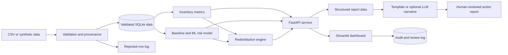

# MedFlow Africa

## Build Specification for Codex

### Essential Medicines Stock-out Early Warning and Redistribution Decision Support

## 1. Instruction to Codex

Build a working, portfolio-quality MVP of **MedFlow Africa**, a decision-support application for district health and supply-chain teams.

The application must help a user identify essential medicines at risk of stock-out, investigate the evidence behind each alert, find possible redistribution opportunities, and produce a reviewable action report.

This is a decision-support prototype, not a clinical system. It must not diagnose patients, prescribe treatment, place orders, move stock automatically, or present recommendations as mandatory decisions.

Build the smallest reliable version first. Use synthetic or properly anonymised data only.

## 2. Product Objective

District health teams often work with incomplete inventory records spread across spreadsheets and separate reporting systems. This can make it difficult to identify impending stock-outs early, distinguish genuine risk from poor reporting, and determine whether stock can be redistributed before an emergency order is required.

MedFlow Africa should turn facility-level inventory and supply data into four practical outputs:

1. A ranked list of medicines and facilities at risk of stock-out.
2. An estimate of current stock cover and the evidence behind each risk classification.
3. Feasible redistribution suggestions from facilities with excess or near-expiry stock.
4. A concise action report for human review and follow-up.

## 3. Intended Users

### Primary users

- District pharmacists and logistics officers
- Health programme managers
- Medical stores and supply-chain officers
- Monitoring, evaluation and data teams

### Secondary users

- State or national health planners
- Procurement and finance teams
- Implementing partners supporting medicine availability

## 4. Decisions the Product Supports

The product should help a user decide:

- Which medicine-facility combinations need attention first?
- Is the risk caused by consumption, delayed supply, poor reporting or another identifiable factor?
- Which facilities may have enough stock to support a redistribution?
- How much stock could be moved without putting the supplying facility at risk?
- Which recommendations need validation, procurement action or escalation?

The product must show the underlying data, assumptions and uncertainty so the user can accept, reject or modify a recommendation.

## 5. MVP Scope

Build the prototype around:

- One fictional district
- 10 health facilities
- 10 essential medicines
- At least 12 months of weekly inventory records
- Synthetic facility, stock, consumption, delivery, order and expiry data
- Forecast windows of 14 and 30 days
- CSV upload plus bundled demonstration data
- A FastAPI backend
- A Streamlit user interface
- SQLite for application and audit records
- A deterministic baseline plus one evaluated machine-learning model
- Optional LLM-generated summaries that can be disabled without breaking the application

## 6. Out of Scope for the MVP

- Patient-level or personally identifiable health data
- Clinical diagnosis or treatment recommendations
- Automatic ordering, procurement or stock transfers
- Integration with a live government health system
- Claims of regulatory, clinical or production readiness
- Nationwide forecasting
- A mobile application
- Training a foundation model

## 7. Core Functional Requirements

### 7.1 Demonstration dataset

Provide a reproducible generator that creates realistic synthetic records for 10 facilities and 10 medicines. Include normal operations and controlled failure scenarios such as:

- Rapid increases in consumption
- Late or incomplete deliveries
- Stock discrepancies
- Near-expiry surplus
- Missing reports
- Facilities with consistently low reporting completeness
- Rural facilities with longer replenishment lead times

Use a fixed random seed so results can be reproduced.

### 7.2 Data ingestion and validation

The application must:

- Accept the bundled demonstration dataset or user-uploaded CSV files.
- Validate required columns, data types, date ranges and allowed values.
- Detect negative stock, impossible expiry dates, duplicate rows, missing identifiers and inconsistent balances.
- Produce a data-quality summary before running analysis.
- Keep invalid records out of model inputs while preserving them in a rejection log.
- Record the source filename, import time, row count and validation result.

### 7.3 Inventory analysis

Calculate at minimum:

- Average daily consumption
- Current usable stock
- Days of stock cover
- Reorder point
- Order fulfilment rate
- Delivery delay
- Reporting completeness
- Quantity approaching expiry
- Consumption trend

Display the actual value first, followed by its comparison with the relevant threshold or target.

### 7.4 Stock-out risk

For each facility-medicine combination, return:

- 14-day stock-out risk
- 30-day stock-out risk
- Risk category: high, medium or low
- Probability or calibrated risk score
- Estimated days of stock remaining
- Three to five contributing factors
- Data-quality warning when evidence is incomplete

Use consistent status colours:

- Green: low risk or on track
- Amber: medium risk or requires attention
- Red: high risk or immediate review required

### 7.5 Redistribution recommendations

The system should identify possible donor and recipient facility pairs. A recommendation must include:

- Medicine
- Recipient facility
- Potential donor facility
- Suggested quantity
- Recipient days of cover before and after the transfer
- Donor days of cover before and after the transfer
- Expiry date or remaining shelf life
- Distance or transfer-cost proxy
- Reason for the recommendation
- Constraints or warnings

Do not recommend a transfer when:

- The donor would fall below its configured safety-stock threshold.
- The stock would probably expire before use at the recipient facility.
- Data quality is below the minimum threshold.
- The transfer quantity is below one valid pack size.
- The recommendation depends on missing critical data.

Every recommendation must require human approval.

### 7.6 Bottleneck diagnostics

Classify likely operational bottlenecks using transparent rules. Initial categories should include:

- Consumption surge
- Delayed delivery
- Unfilled or partially filled order
- Insufficient order quantity
- Reporting gap
- Stock-record discrepancy
- Near-expiry overstock
- No identifiable cause

The application must distinguish a confirmed fact from an inferred cause.

### 7.7 Dashboard

Create the following pages:

1. **District overview**
   - High-, medium- and low-risk counts
   - Facilities reporting on time
   - Medicines with the highest district-wide risk
   - Potential redistribution opportunities
   - Data-quality warnings

2. **Risk explorer**
   - Filter by facility, medicine, risk level and forecast window
   - Ranked risk table
   - Stock and consumption trend chart
   - Explanation of contributing factors

3. **Redistribution planner**
   - Donor-recipient recommendations
   - Before-and-after stock-cover comparison
   - Accept, reject or edit controls for demonstration purposes
   - Mandatory reviewer note

4. **Data quality**
   - Completeness, timeliness, validity and consistency results
   - Rejected rows and reasons
   - Facility-level quality comparison

5. **Action report**
   - Reviewable district summary
   - Priority risks
   - Proposed transfers
   - Bottlenecks
   - Named actions, owners and due dates entered by the user
   - PDF or HTML export

### 7.8 Explanation and report generation

The application must work without an LLM by using deterministic templates.

If an LLM is enabled:

- Send only validated, structured findings to the model.
- Do not send raw patient data or secrets.
- Require the model to use only supplied facts.
- Require each narrative statement to point to a supplied metric or finding identifier.
- Reject unsupported numbers, facilities or medicine names.
- Label the narrative as an AI-assisted draft pending human review.
- Preserve the structured input, prompt version and output in the audit log.

The LLM must explain approved analysis; it must not calculate stock-out risk or determine transfer quantities.

## 8. Data Model

### 8.1 `facilities`

| Field | Type | Description |
|---|---|---|
| `facility_id` | string | Unique facility identifier |
| `facility_name` | string | Display name |
| `facility_type` | category | Hospital, health centre or clinic |
| `location_type` | category | Urban, peri-urban or rural |
| `latitude` | float | Synthetic latitude |
| `longitude` | float | Synthetic longitude |
| `lead_time_days` | integer | Expected replenishment lead time |
| `reporting_target` | float | Expected reporting completeness |

### 8.2 `medicines`

| Field | Type | Description |
|---|---|---|
| `medicine_id` | string | Unique medicine identifier |
| `medicine_name` | string | Generic medicine name |
| `category` | string | Therapeutic or programme category |
| `pack_size` | integer | Units per valid transfer pack |
| `safety_stock_days` | integer | Minimum desired stock cover |
| `shelf_life_days` | integer | Expected shelf life |

### 8.3 `inventory_records`

| Field | Type | Description |
|---|---|---|
| `record_id` | string | Unique row identifier |
| `reporting_date` | date | Weekly reporting date |
| `facility_id` | string | Facility reference |
| `medicine_id` | string | Medicine reference |
| `opening_balance` | integer | Opening usable units |
| `quantity_received` | integer | Units received during the period |
| `quantity_dispensed` | integer | Units consumed or dispensed |
| `adjustments` | integer | Documented corrections or losses |
| `closing_balance` | integer | Closing usable units |
| `stockout_days` | integer | Days unavailable during the period |
| `expiry_date` | date | Earliest relevant batch expiry |
| `quantity_near_expiry` | integer | Units within the configured expiry window |
| `report_submitted_on_time` | boolean | Timeliness indicator |

### 8.4 `orders`

| Field | Type | Description |
|---|---|---|
| `order_id` | string | Unique order identifier |
| `facility_id` | string | Ordering facility |
| `medicine_id` | string | Ordered medicine |
| `order_date` | date | Date submitted |
| `quantity_ordered` | integer | Requested units |
| `expected_delivery_date` | date | Expected delivery date |
| `actual_delivery_date` | date or null | Actual delivery date |
| `quantity_delivered` | integer | Delivered units |
| `order_status` | category | Pending, partial, fulfilled or cancelled |

### 8.5 `recommendation_reviews`

| Field | Type | Description |
|---|---|---|
| `recommendation_id` | string | Unique recommendation identifier |
| `created_at` | datetime | Generation time |
| `recipient_facility_id` | string | Proposed recipient |
| `donor_facility_id` | string | Proposed donor |
| `medicine_id` | string | Medicine reference |
| `suggested_quantity` | integer | Proposed transfer quantity |
| `status` | category | Pending, accepted, edited or rejected |
| `reviewer_note` | string | Required human rationale |
| `reviewed_at` | datetime or null | Review time |

## 9. Analytical and Modelling Approach

### 9.1 Deterministic baseline

Implement a transparent baseline first:

```text
average_daily_consumption = recent_quantity_dispensed / observed_days
days_of_cover = current_usable_stock / average_daily_consumption
baseline_stockout_risk = days_of_cover < forecast_window
```

Handle zero consumption and missing periods explicitly. Do not silently divide by zero or impute critical values without recording the method.

### 9.2 Machine-learning model

Train one interpretable tabular model to predict whether a stock-out will occur within the selected forecast window.

Start with logistic regression as the benchmark. A tree-based model such as histogram gradient boosting may be added if it produces a meaningful and reproducible improvement.

Candidate features:

- Current days of cover
- Recent average consumption
- Consumption trend and volatility
- Stock received during recent periods
- Open order quantity
- Delivery delay
- Order fulfilment rate
- Facility lead time
- Reporting completeness
- Previous stock-out days
- Quantity near expiry
- Facility type and location type
- Medicine category

Use time-based train, validation and test splits. Never randomly mix later records into the training period.

### 9.3 Model evaluation

Report:

- Precision and recall for high-risk alerts
- F1 score
- Precision-recall AUC
- Brier score or another calibration measure
- Confusion matrix
- Performance against the deterministic baseline
- Performance by facility type, location type and medicine category
- Results when records are missing or delayed

Select the operating threshold based on an explicit trade-off. Missing a genuine stock-out should be treated as more serious than requiring a reviewer to inspect an additional alert, but excessive false alarms must still be measured and disclosed.

### 9.4 Redistribution logic

Use deterministic constraints or linear optimisation. Do not use an LLM to calculate transfer quantities.

The objective should prioritise:

1. Reducing the recipient's immediate stock-out risk.
2. Preserving the donor's safety stock.
3. Using near-expiry stock where it can be consumed safely.
4. Minimising distance or a documented transfer-cost proxy.

Round every quantity down to a valid pack size.

## 10. Responsible AI and Safety Requirements

- Use synthetic or anonymised operational data only.
- Do not collect patient names, diagnoses or personal identifiers.
- Display model confidence and data-quality warnings.
- Keep forecasts, inferred causes and confirmed facts visually distinct.
- Provide an explanation for every high-risk classification and recommendation.
- Require human review for every redistribution action.
- Record model version, data version, thresholds and review decisions.
- Measure performance across rural, urban and facility-type groups.
- Document known limitations and failure conditions.
- Provide a way to run the system without an external LLM.
- Keep API keys in environment variables and provide a safe `.env.example`.
- Never place real credentials in the repository, logs or exported reports.

## 11. Proposed Architecture



## 12. API Requirements

Implement at least:

- `GET /health`
- `POST /data/import`
- `GET /data/quality`
- `GET /risk/summary`
- `GET /risk/details`
- `GET /redistribution/recommendations`
- `POST /redistribution/{recommendation_id}/review`
- `GET /reports/action-report`
- `GET /audit/events`

Use Pydantic request and response models. Return clear validation errors without exposing stack traces or secrets.

## 13. Suggested Repository Structure

```text
medflow-africa/
├── README.md
├── AGENTS.md
├── LICENSE
├── pyproject.toml
├── .env.example
├── .gitignore
├── app/
│   ├── api/
│   ├── core/
│   ├── data/
│   ├── models/
│   ├── services/
│   ├── reporting/
│   └── main.py
├── dashboard/
│   └── streamlit_app.py
├── scripts/
│   ├── generate_demo_data.py
│   ├── train_model.py
│   └── evaluate_model.py
├── data/
│   ├── demo/
│   └── schemas/
├── model_artifacts/
├── reports/
├── tests/
│   ├── unit/
│   ├── integration/
│   └── fixtures/
└── docs/
    ├── architecture.md
    ├── evaluation.md
    ├── responsible_ai.md
    ├── data_dictionary.md
    └── user_guide.md
```

## 14. Engineering Standards

- Use Python type hints.
- Keep business logic outside the user-interface code.
- Add docstrings to public modules and functions.
- Use configuration files or environment variables instead of hard-coded thresholds.
- Add structured logging without secrets or sensitive records.
- Write deterministic unit tests for calculations and recommendation constraints.
- Add integration tests for import, risk and review workflows.
- Use a fixed seed for synthetic data and model training.
- Pin or constrain dependency versions.
- Provide commands for setup, testing, training and running the application.
- Ensure the dashboard remains usable when the optional LLM is unavailable.

## 15. Minimum Test Coverage

Tests must cover:

- Inventory-balance validation
- Missing and duplicate records
- Days-of-cover calculation
- Zero-consumption handling
- Risk-band assignment
- Time-based dataset splitting
- Model input and output schemas
- Donor safety-stock constraint
- Pack-size rounding
- Expiry constraint
- Data-quality threshold constraint
- Recommendation accept, edit and reject workflow
- LLM-disabled report generation
- Unsupported claims or numbers in an LLM-assisted draft

## 16. Acceptance Criteria

The MVP is complete when:

- A user can load the demonstration data without editing code.
- Invalid records are separated and explained.
- The dashboard ranks 14- and 30-day stock-out risks.
- Every alert shows its actual metrics, risk score, contributing factors and data-quality status.
- The system produces only feasible redistribution suggestions under the configured rules.
- A reviewer can accept, edit or reject a suggestion with a note.
- The system records the review decision in an audit log.
- The model evaluation compares the ML model with the deterministic baseline.
- Evaluation includes calibration and subgroup performance.
- Reports can be generated with the LLM disabled.
- Optional LLM narratives are grounded only in structured findings and clearly marked for review.
- The full automated test suite passes.
- The README documents the problem, users, architecture, evaluation, responsible-use controls and limitations.

## 17. Demonstration Scenario

The demonstration should include at least these cases:

1. A rural clinic is likely to run out of a high-use medicine because consumption increased and its delivery is late.
2. A nearby health centre has surplus stock but cannot donate below its safety threshold.
3. A hospital has near-expiry stock that can be safely transferred and consumed before expiry.
4. One apparent stock-out is withheld from recommendation because reporting completeness is too low.
5. A district manager reviews the proposed transfer, edits the quantity, adds a reason and exports the action report.

## 18. Portfolio Presentation

### Project title

**MedFlow Africa — Essential Medicines Stock-out and Redistribution Decision Support**

### Short portfolio description

MedFlow Africa helps district health teams identify essential medicines at risk of stock-out, investigate the operational evidence behind each alert and review feasible redistribution opportunities. The prototype combines validated facility data, interpretable predictive modelling, constrained optimisation and human-reviewed explanations.

### Evidence to show reviewers

- Architecture diagram
- Data dictionary
- Model card and evaluation results
- Baseline comparison
- Responsible-AI and privacy note
- Screenshots of the five dashboard pages
- Example action report
- Automated test results
- Known limitations and proposed next steps

## 19. Final Build Rule

Prioritise correctness, traceability and usability over the number of features. Do not describe the prototype as deployed, clinically validated or government-approved. Any performance claim must come from the bundled evaluation outputs and must state that the data is synthetic.
