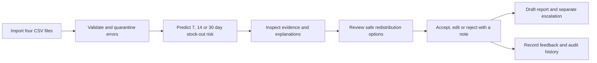

# MedFlow Africa

Explainable AI decision support for essential-medicine stock-out risk, constrained redistribution and evidence-grounded action briefs. Built from the six specifications supplied in this folder, with the user's expanded AI workflow and reporting standards.

**All bundled inventory and programme data is synthetic.** This prototype does not diagnose, prescribe, order medicines or execute transfers.

Live website: **https://medflow-africa.vercel.app**.

Source repository: **https://github.com/alumond/medflow-africa** (public).

## How the app works

You do not need to import data to explore the website: bundled example records load automatically. Import data when you want decisions about your own facilities. The app needs actual balances, consumption, expiry dates and delivery records; a model cannot discover those facts from facility names alone.



| File | What it supplies | Why it matters |
| --- | --- | --- |
| `facilities.csv` | Facility IDs, names, location and lead times | Identifies sites and supply constraints. |
| `medicines.csv` | Medicine IDs, pack sizes and safety-stock policies | Keeps calculations and proposed quantities consistent. |
| `inventory.csv` | Weekly balances, receipts, dispensing, expiry and reporting dates | Establishes usable stock, demand, cover and evidence quality. |
| `orders.csv` | Order quantities, expected dates and delivery status | Reveals late or uncertain replenishment. |

Use **Import data**, choose all four files, set the reporting cut-off and confirm the records contain no patient identifiers. Fix rejected records through **Data quality**. A failed import keeps the previous active dataset. Submit an updated bundle when reporting changes; there is no live connection to facility systems in this build.

Review risk in **District overview** and **Risk explorer**, then inspect **Redistribution planner**. Safety checks preserve donor buffers, expiry requirements and whole packs. A recorded review never executes a transfer. **Supply brief** creates the thirteen-section report and a separate email draft for review and manual sending.

Current scope: the importer replaces operational inventory and orders. Workplan, logframe and budget ledgers remain invented examples. Model performance is based on a synthetic holdout, and free-tier Gemini drafting is currently restricted to approved example summaries; imported operational data uses the deterministic reporting path.

See the [user guide](docs/user_guide.md) and [screenshot gallery](docs/screenshots/README.md).

## Start locally

Python 3.12 is recommended. The implementation also supports Python 3.9–3.11 locally.

```sh
python3 -m venv .venv
source .venv/bin/activate
pip install -e '.[analysis,dev]'
python -m scripts.generate_demo_data
python -m scripts.train_model
python -m scripts.run
```

Open **http://127.0.0.1:8000**. Demonstration data loads automatically. The five operational pages are District Overview, Risk Explorer, Redistribution Planner, Data Quality and Supply Brief. Contextual explanations and drafting are integrated into the operational pages. Model oversight is available through Method & limitations.

The optional Streamlit host embeds the same custom interface:

```sh
streamlit run dashboard/streamlit_app.py
```

Keep the FastAPI service running on port 8000. Streamlit is a local alternative; Vercel hosts FastAPI and the custom browser interface directly.

## What works

- Reproducible 60-week dataset: 10 facilities, 10 medicines, linked orders and controlled failure scenarios.
- Four-file versioned CSV imports, checksums, reference/type/date/balance validation, quarantine and downloadable rejection reasons.
- Actual stock, daily consumption, safety stock, cover, reporting quality and 7-, 14- and 30-day predictions.
- Logistic regression versus gradient boosting, selected using validation data only. Purged chronological splits, standalone and combined alert metrics, calibration bins, subgroup and stress results are bundled in `model_artifacts/evaluation.json`.
- Local model explanations from logistic coefficients or additive tree-path contributions, with causal limitations disclosed.
- Pack-aligned, expiry-safe transfer proposals with shared donor reservations, mandatory notes, safe edits, version conflicts and append-only history.
- Synthetic programme workplan, logframe, indicators, issues and a reconciled US$185,000 budget. These fictional programme ledgers remain labelled when operational inventory is imported.
- Complete 13-section operational supply brief, self-contained HTML export with embedded Garamond, print-to-PDF and separate `.eml` escalation draft.
- Gemini-assisted fact selection and executive framing, with citation-bound facts and deterministic fallback.
- Contextual operational explanations, review-feedback counts, holdout monitoring and current feature-shift triggers.

## Gemini setup

Set `GEMINI_API_KEY` on the **server**, and optionally `GEMINI_MODEL=gemini-3.8-flash`. Locally, use an ignored `.env.local` file. On Vercel, add a sensitive environment variable for the target environments and redeploy. Never put the key in browser JavaScript or commit it.

As verified on 4 November 2026, [Google lists Gemini 3.8 Flash with free-tier input/output tokens](https://ai.google.dev/gemini-api/docs/pricing). Free access has quotas; the model name alone does not guarantee that a billing-enabled project will incur no charges. Use a free-tier Google AI Studio project without billing to stay on free quotas. Google's free tier may use content to improve its products.

The integration therefore permits **synthetic summary facts only**. Gemini selects and sequences fact IDs and approved connective wording. The server inserts all actual numbers, names and factual sentences. Unsupported fields, entities, quantities or wording are rejected. Management notes, reviewer notes, raw uploads and free-form copilot questions are never transmitted. The current API uses the [Interactions API](https://ai.google.dev/gemini-api/docs/text-generation) with JSON-schema output and revision `2026-05-20`.

There are no automatic paid-model fallbacks, tools or search calls. Gemini 3.8 Flash remains primary; service errors/timeouts may use one verified free-tier Gemini 3.5 Flash-Lite fallback. Each attempt counts toward the workspace ceiling. Requests have a bounded connection/read timeouts, bounded output, cached fact bundles and a 10-request daily workspace ceiling. Missing key, quota failure, timeout and unsupported output all leave deterministic reporting available. AI-assisted copy is labelled pending human review.

## Verification

```sh
python -m pytest -q --cov=app --cov-branch
python -m ruff check app scripts dashboard tests
python -m ruff format --check app scripts dashboard tests
python -m mypy app/core app/data app/models app/services app/reporting
node --check app/web/assets/app.js
```

Tests use isolated databases and fake external transports; they do not spend API quota. See `docs/verification.md` for results and remaining release limitations.

## Deployment

The selected target is **almondowolabi01-gmailcoms-projects / medflow-africa** on Vercel. `vercel.json` targets the supported `app/main.py` FastAPI entrypoint. The deployment uses Python 3.12 and only lightweight runtime dependencies; scientific/Streamlit packages are optional local extras.

Vercel stores each browser workspace in a private Blob, keyed by an unguessable HttpOnly cookie. Each request opens a temporary SQLite copy, applies normal transactional constraints, then commits changed bytes using the prior Blob ETag. Origin reads bypass CDN caches. Concurrent writes return a conflict instead of overwriting a review. Losing the cookie loses access to that workspace; this is not a multi-user identity or recovery system. Keep operational use behind Vercel deployment protection. Do not expose this prototype as a production health service.

## Design and documentation

Garamond headings, Helvetica body/UI, ivory surfaces, charcoal text and muted blue. Semantic green/amber/red is reserved for status. The interface uses publication-like hierarchy, ruled data tables and a decision desk rather than a tile-heavy dashboard.

See `docs/architecture.md`, `docs/model_card.md`, `docs/responsible_ai.md`, `docs/data_dictionary.md`, `docs/user_guide.md` and `docs/requirements_traceability.csv`. The uploaded documents remain unchanged. The PRD references a technical-design document numbered 02 that was not present in the supplied folder.

Latest product direction: no prominent demonstration badge or standalone assistant branding. Dataset origin remains in source details. Supply briefs follow the user’s thirteen-section report structure, with specific operational prose focused on medicine availability, safe options and accountable next steps.
