# MedFlow Africa screenshots

Fresh captures of the live website on 4 November 2026. All five main pages, the model record, report tabs and decision-support views are included. Images use an isolated browser workspace with the bundled example records. No review decisions, transfers or emails were submitted.

[Open the local gallery](index.html) · [Live website](https://medflow-africa.vercel.app)

### District overview

[Open full-resolution PNG](01-district-overview.png)

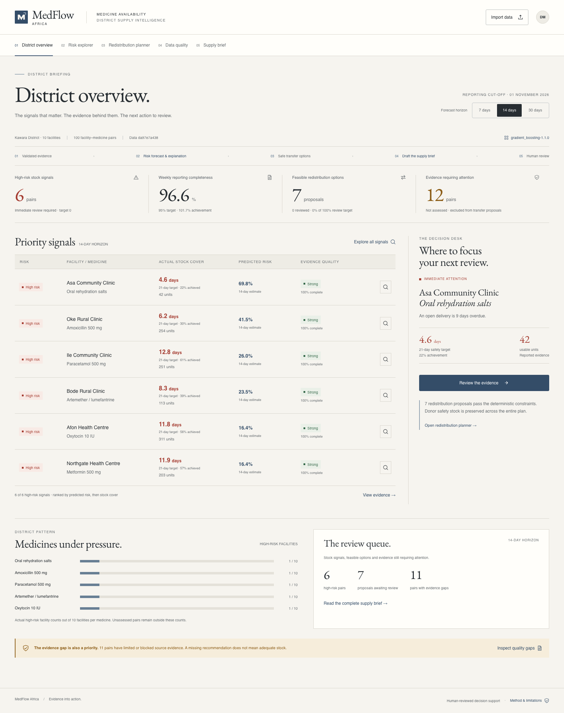

### Risk explorer — first screen

[Open full-resolution PNG](02-risk-explorer.png)

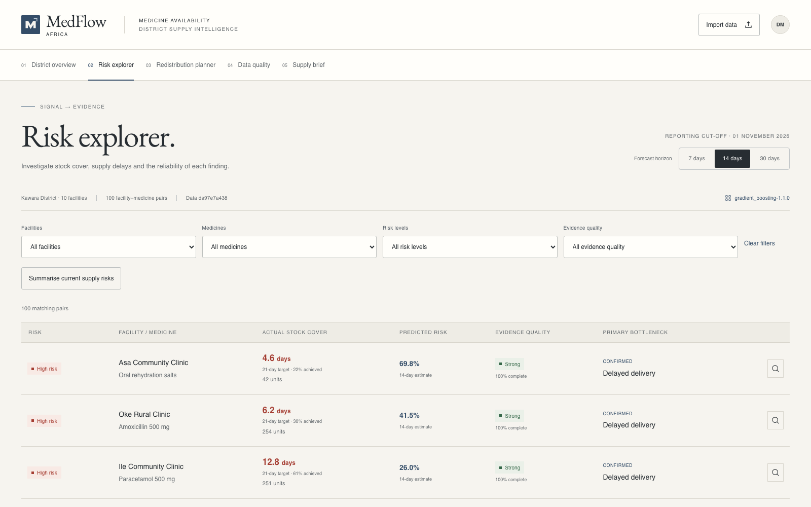

### Risk explorer — complete table

[Open full-resolution PNG](02b-risk-explorer-full.png)

### Individual stock risk and model factors

[Open full-resolution PNG](03-risk-detail.png)

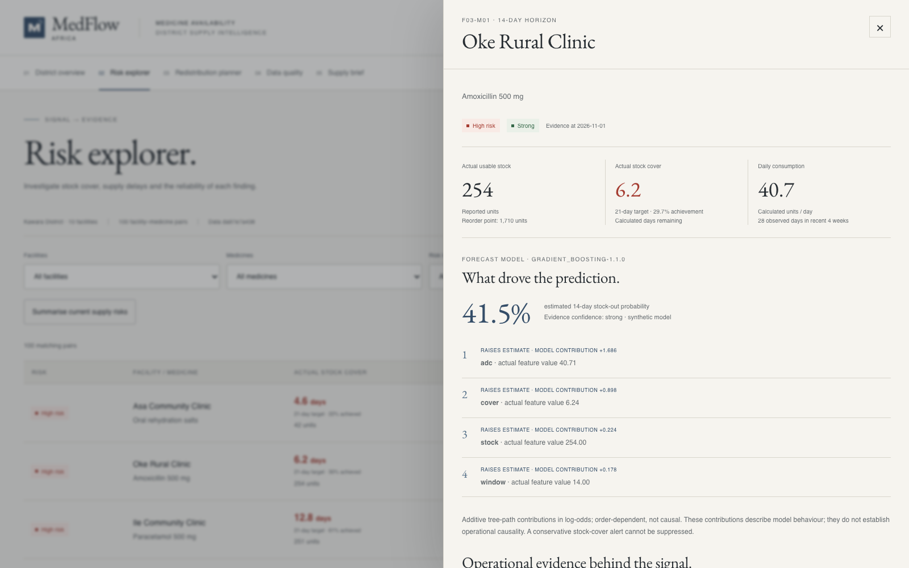

### Contextual explanation with source records

[Open full-resolution PNG](11-integrated-explanation.png)

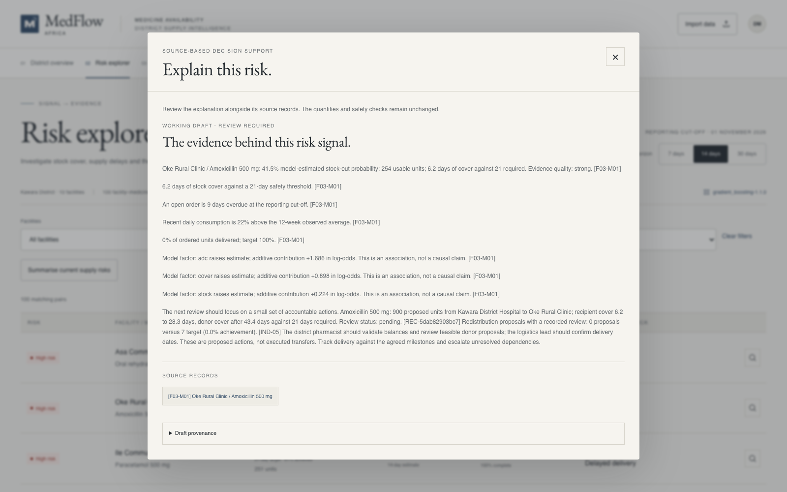

### Safe redistribution options

[Open full-resolution PNG](04-redistribution-planner.png)

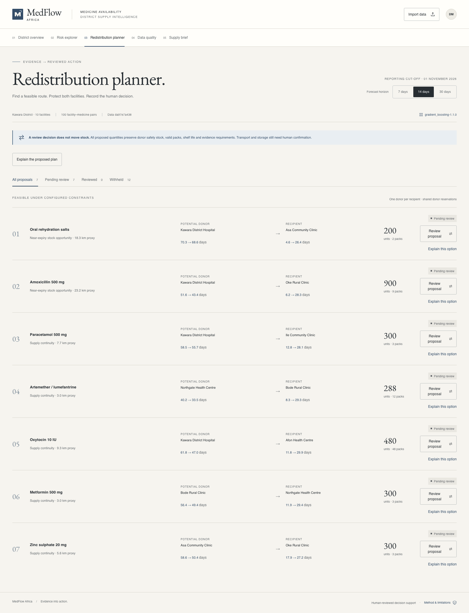

### Human review and safety constraints

[Open full-resolution PNG](05-transfer-review.png)

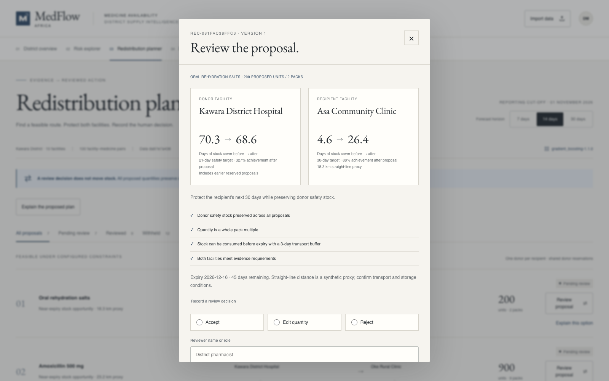

### Data quality and rejected records

[Open full-resolution PNG](06-data-quality.png)

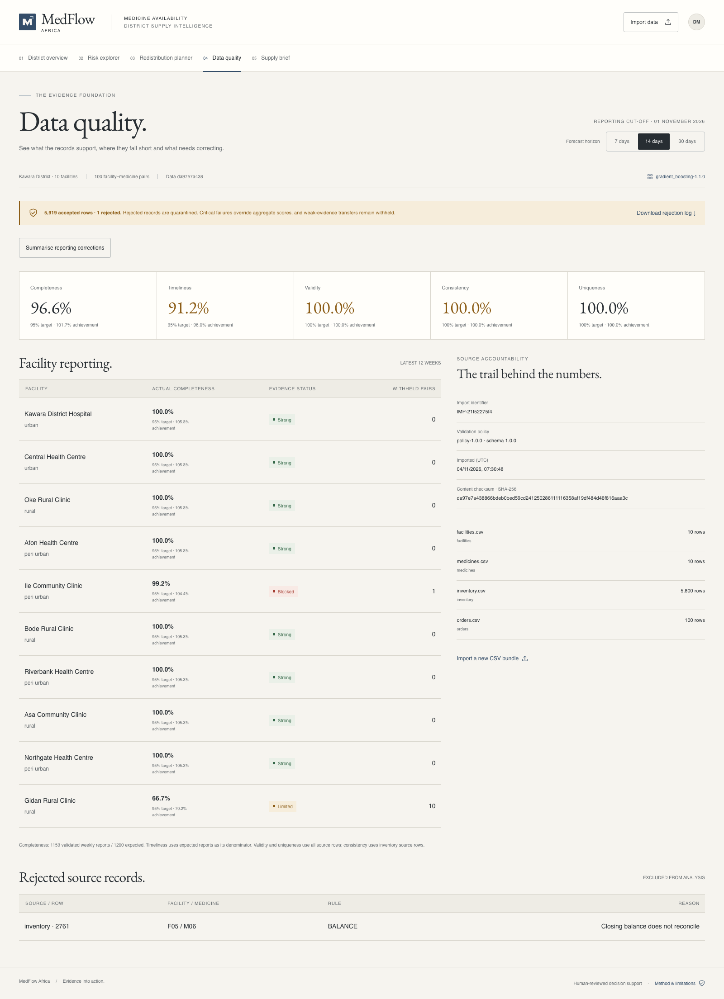

### Four-file data import

[Open full-resolution PNG](07-data-import.png)

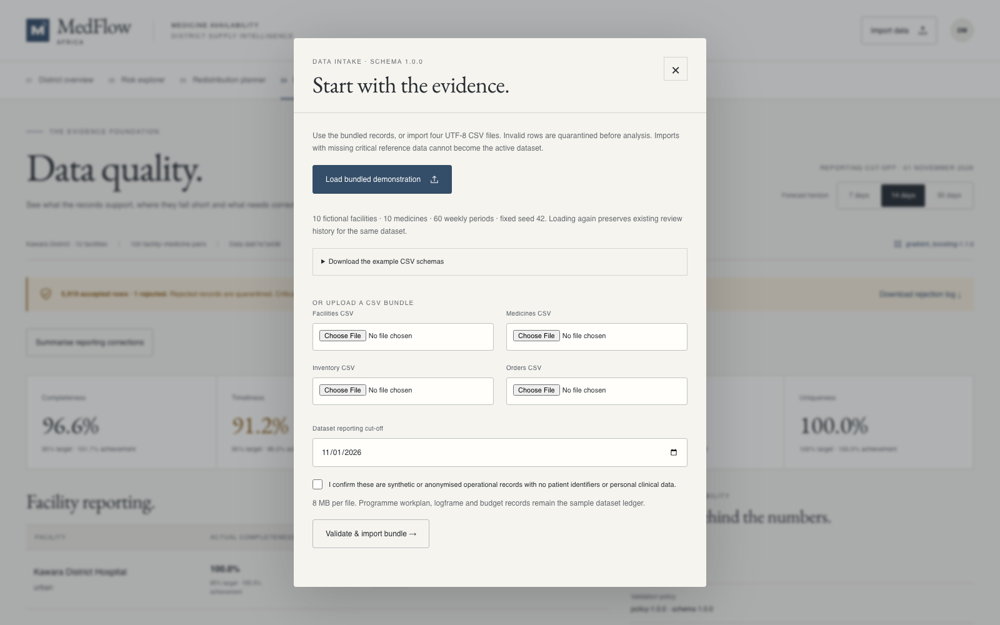

### Operational executive preview

[Open full-resolution PNG](08-supply-brief.png)

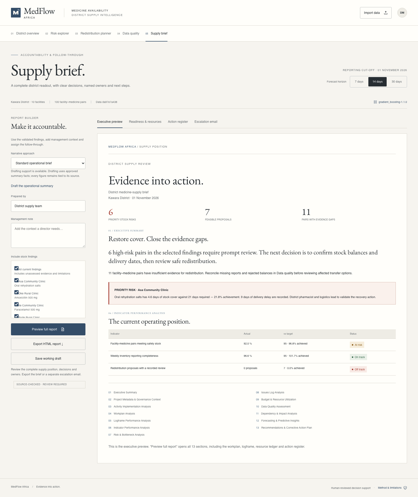

### Labelled example project resources

[Open full-resolution PNG](12-project-resources.png)

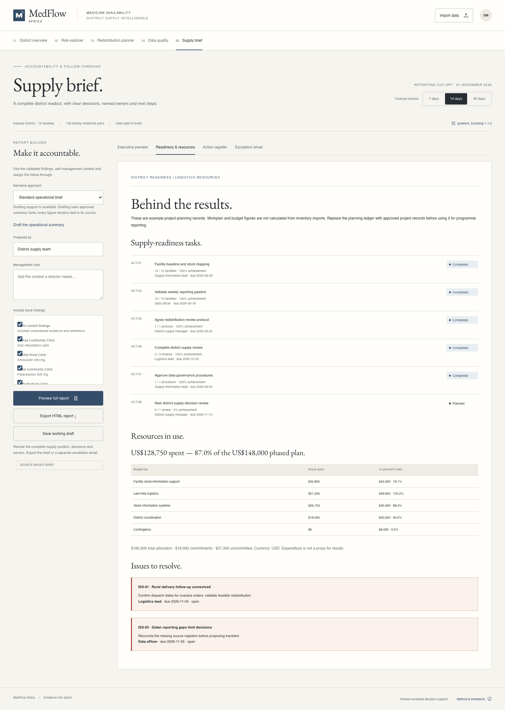

### Actions, owners and deadlines

[Open full-resolution PNG](13-action-register.png)

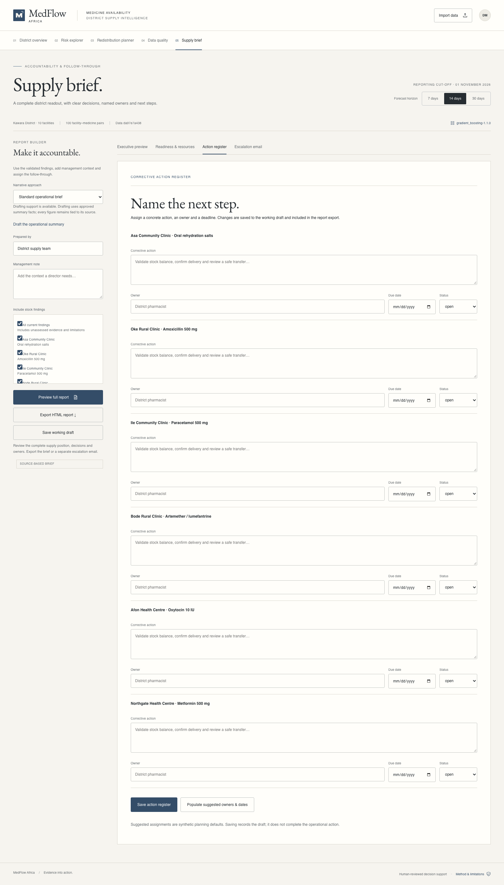

### Separate escalation draft — no email sent

[Open full-resolution PNG](10-escalation-draft.png)

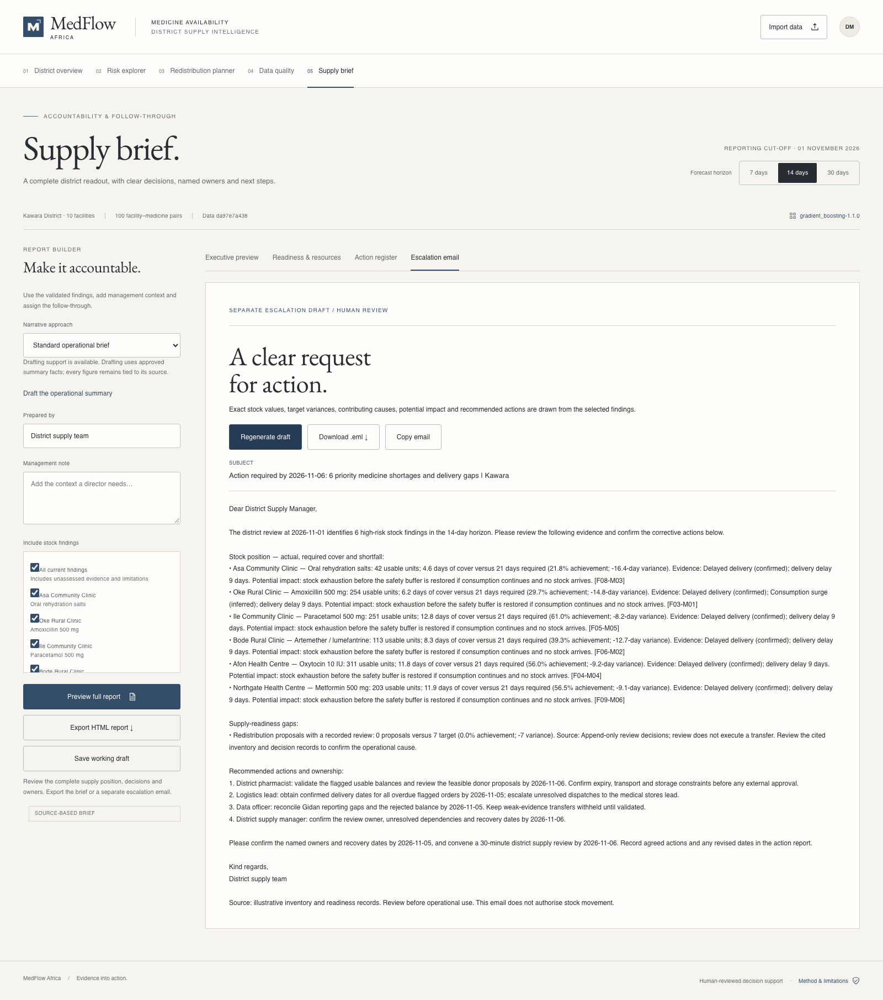

### Full report preview and export controls

[Open full-resolution PNG](09-report-preview.png)

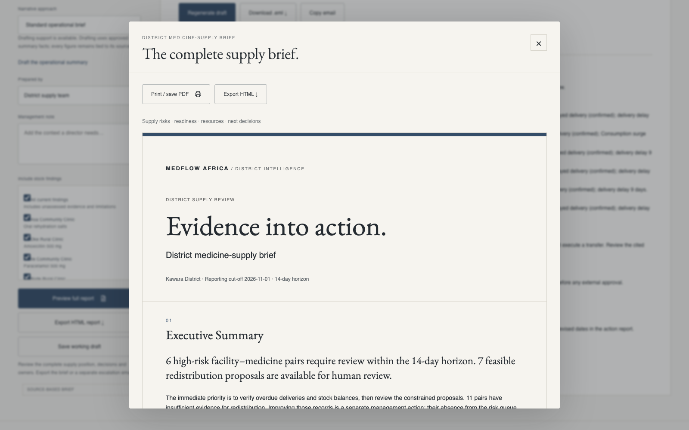

### All thirteen report sections

[Open full-resolution PNG](09b-complete-report.png)

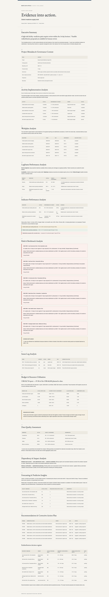

### Model evaluation, drift and review feedback

[Open full-resolution PNG](14-model-performance.png)

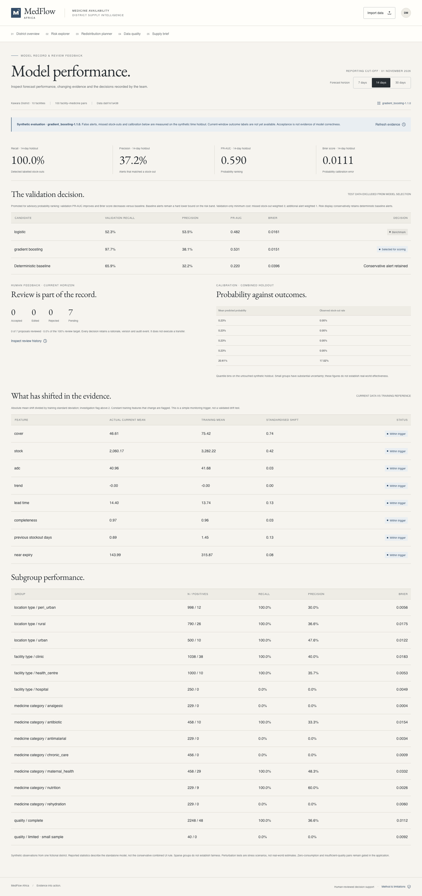

### Mobile district overview

[Open full-resolution PNG](15-mobile-overview.png)

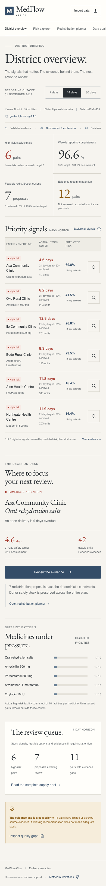
